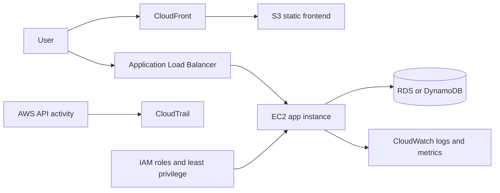
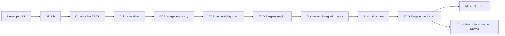
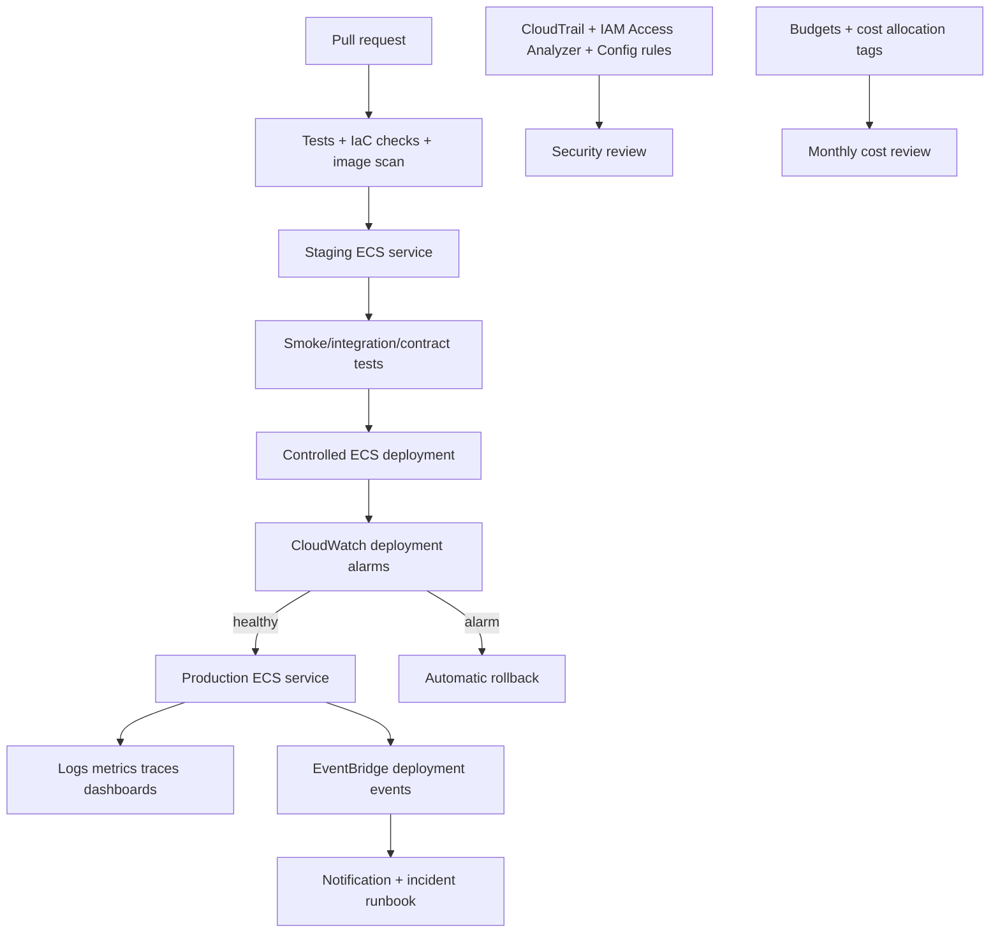
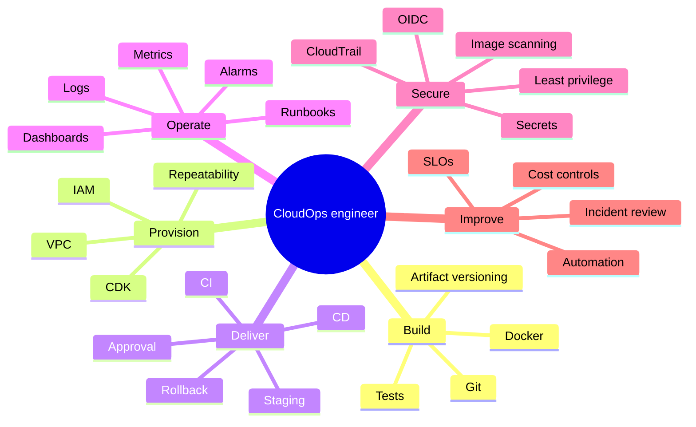

# AWS CloudOps / DevOps Portfolio: Three Levels to Job-Ready

**Target:** junior-to-mid DevOps / CloudOps first IT job

**Recommended strategy:** build one small production-like application three times. Each level keeps the same application and improves its delivery, security, reliability, and operations. This demonstrates engineering growth better than three unrelated toy projects.

The portfolio should prove that you can deploy, operate, troubleshoot, secure, and explain an AWS workload—not only create resources in the console.

## The portfolio product

Use a small API-backed application such as a task tracker, URL shortener, or incident-notes app. Keep the business logic simple. The engineering system is the portfolio:

- Application: Python FastAPI or Node.js API with unit tests and a health endpoint.
- Source: GitHub with pull requests, issues, ADRs, and a useful README.
- Infrastructure: AWS CDK in Python or TypeScript. Use CloudFormation through CDK rather than clicking resources into existence.
- Delivery: start with a repeatable manual/CLI deployment, then automate CI/CD.
- Operations: logs, metrics, alarms, runbooks, failure injection, and cost cleanup.

A small application is enough. A clearly documented failure, diagnosis, rollback, and post-incident improvement is more valuable than adding unnecessary microservices.

## Level 1 — CloudOps Foundation: deploy and operate one workload

**Job signal:** “I can build a secure, repeatable AWS environment and troubleshoot a running application.”

### Architecture

### Build scope

1. Create a VPC with public and private subnets, route tables, security groups, and clear CIDR documentation.
2. Deploy the API to one EC2 instance behind an Application Load Balancer. Keep the first version intentionally understandable.
3. Store the frontend in S3 and serve it through CloudFront if you include a frontend.
4. Use an IAM instance role; do not store AWS access keys on the server.
5. Add CloudWatch logs, a CPU or health alarm, and a documented manual rollback.
6. Provision the environment with CDK. The README must include `cdk diff`, deploy, destroy, and recovery instructions.
7. Add budgets, tagging, and a cleanup script. Delete or stop resources after each lab session.

### Mini-labs

- **Networking lab:** explain why the ALB can be public while the database is private; use security-group references instead of broad CIDR rules.
- **IAM lab:** start with a broad role in a disposable environment, collect CloudTrail activity, then use IAM Access Analyzer guidance to reduce permissions.
- **Troubleshooting lab:** deliberately break the app health check, use ALB target health, EC2 system/application logs, and CloudWatch to locate the fault.
- **Recovery lab:** terminate the instance, recreate it from CDK/user data, and write the exact recovery steps.

### Evidence to publish

- Architecture diagram and a one-page “why this design” ADR.
- `cdk.json`, stack code, `README.md`, deployment transcript, and screenshots of healthy and failed states.
- Network decision record: public/private subnet purpose, route paths, and security-group flows.
- One incident report: symptom, timeline, hypothesis, commands/metrics used, root cause, fix, and prevention.
- A 3–5 minute screen recording showing deploy, test, alarm, diagnosis, and cleanup.

### Exit questions

You should be able to answer: What is a subnet? Why should the database not be public? What is the difference between a security group and a network ACL? Why use an IAM role instead of access keys? What happens when an ALB target fails health checks? How would you reduce the blast radius of this account?

## Level 2 — Delivery Engineer: containerize and automate releases

**Job signal:** “I can build a secure CI/CD pipeline that delivers a containerized service.”

AWS Prescriptive Guidance describes the same core flow used here: a pipeline builds an image, pushes it to Amazon ECR, deploys it to an ECS Fargate service, tests the non-production URL, and then promotes to production with an approval gate. [1]

### Architecture

### Build scope

1. Containerize the API with a multi-stage Dockerfile, a non-root runtime user, a small base image, and a deterministic dependency lock file.
2. Replace EC2 application hosting with ECS on Fargate. Keep the database choice simple: DynamoDB for a serverless path or RDS if relational troubleshooting is part of your goal.
3. Create separate staging and production services. Use separate task roles and execution roles.
4. Implement CI/CD with either GitHub Actions plus GitHub OIDC or AWS CodePipeline/CodeBuild. Do not use long-lived AWS keys in GitHub.
5. Add unit tests, linting, image build, image push, deployment, smoke tests, and a manual production approval.
6. Make image tags immutable and deploy a commit SHA rather than `latest`.
7. Add ECR image scanning and block promotion for a deliberately defined high/critical policy. AWS recommends regular image scanning and says images with HIGH or CRITICAL findings should be rebuilt or removed. [2]

### Security proof

For GitHub OIDC, scope the IAM trust policy to the specific organization, repository, and branch/environment. AWS warns that an unrestricted `sub` condition could allow outside repositories to assume the role. [3] Use separate deploy roles for staging and production, and make production approval visible in the pull request or pipeline history.

### Mini-labs

- **Pipeline lab:** submit a PR that fails tests, then a PR that passes and deploys to staging.
- **Supply-chain lab:** introduce an intentionally vulnerable dependency or base image in a branch; show the scan finding and remediation.
- **Rollback lab:** deploy version B, introduce a failing health endpoint, and roll back to version A.
- **IAM lab:** compare the permissions of the build role, task execution role, and application task role. Explain why they are not interchangeable.
- **Secret lab:** store a non-production secret in Secrets Manager or SSM Parameter Store and inject it at runtime; never commit it.

### Evidence to publish

- Pipeline diagram and a redacted successful run URL or screenshots.
- Dockerfile, workflow/buildspec, CDK stacks, task definition, and deployment commands.
- A “failed release” incident report with test failure, scan failure, or deployment rollback.
- A short threat model covering source, build runner, registry, task role, secret, and production account.
- A cost note explaining Fargate task sizing and the decision to stop/delete non-production resources when idle.

### Level 2 exit criteria

You can explain the difference between a container image, task definition, task, service, and cluster; why Fargate does not remove IAM/networking responsibilities; how CI authenticates without static keys; how the image reaches ECR; how a deployment becomes healthy; and how to roll back without manually editing a running task.

## Level 3 — Production-minded CloudOps: reliability, observability, and controlled change

**Job signal:** “I can operate a service with measurable reliability and safe change practices.”

### Architecture

### Build scope

1. Split infrastructure into reusable CDK constructs or stacks for network, data, service, and pipeline. Add dev/staging/prod configuration without copying code.
2. Use a safe deployment strategy. Start with ECS rolling deployment plus CloudWatch deployment alarms and rollback; optionally demonstrate blue/green or canary after the basic path works.
3. Configure alarms for availability, HTTP 5xx, latency, unhealthy targets, task restarts, and a business metric such as failed job creation.
4. Add dashboards, structured JSON logs, correlation/request IDs, log retention, and a documented alert owner.
5. Add synthetic smoke tests after deployment and a rollback decision. AWS documents that ECS deployment alarms can fail a deployment and optionally roll it back to the last completed deployment. [4]
6. Add security controls: least-privilege roles, IAM Access Analyzer, CloudTrail, encryption, private data access, ECR scanning, dependency scanning, and secret rotation or a rotation plan.
7. Write an operational runbook and conduct a game day: high error rate, bad image, task crash loop, unavailable dependency, and expired secret.
8. Add a basic multi-account or account-boundary discussion. For a portfolio, a separate production account is better than pretending a single account is enterprise governance.

### Mini-labs

- **Safe deployment lab:** deploy a latency regression, trigger a CloudWatch alarm, observe ECS mark the deployment failed, and confirm rollback.
- **Observability lab:** answer “what changed, who deployed it, which endpoint failed, and how many users were affected?” using only logs, metrics, events, and audit trails.
- **Game-day lab:** stop tasks or deny one narrowly scoped dependency permission. Restore service using the runbook and record mean time to detect and recover.
- **Cost lab:** compare idle staging cost with scheduled shutdown, smaller tasks, and one shared non-production service. Record assumptions rather than claiming exact savings.
- **IaC safety lab:** run `cdk diff` in pull requests and reject unreviewed production changes.

### Evidence to publish

- Service-level objective such as “99% successful requests during the lab window” and the measurement method.
- Dashboard screenshot, alarm definitions, deployment history, rollback evidence, and incident timeline.
- One post-incident review with a permanent corrective action.
- Security review showing trust policies, Access Analyzer findings, CloudTrail evidence, and remediation.
- Disaster/recovery decision: what is backed up, what is recreated from IaC, the recovery time objective, and the residual risk.
- A final portfolio README that lets a reviewer reproduce the system in under 30 minutes and destroy it safely.

### Level 3 exit questions

You should be able to explain an SLO versus an alarm threshold, why an alarm can be noisy, what makes a rollback safe, how ECS decides a deployment is healthy, how you investigate a 5xx spike, how you identify the deployer, what your recovery assumptions are, and which controls prevent a CI pipeline from becoming a production backdoor.

## Mind map: connecting the dots

The connection to remember is: **code change → artifact → infrastructure change → deployment health → user signal → alarm → decision → rollback or improvement**. Every portfolio project should show that chain at least once.

## Suggested certification sequence

1. **AWS Certified CloudOps Engineer – Associate (SOA-C03):** make this the near-term target because it aligns directly with deployment, management, monitoring, networking, security, and troubleshooting. AWS says the renamed certification applies to the latest SOA-C03 exam version. [5]
2. **AWS Certified Solutions Architect – Associate (SAA-C03):** take this first if networking, IAM, storage, and high-availability architecture are still weak. It improves design reasoning for all three portfolio levels.
3. **AWS Certified DevOps Engineer – Professional (DOP-C02):** treat this as a later target after real repetition with CI/CD, observability, incident response, and infrastructure as code. Do not use it as a prerequisite for the first job.

For each study topic, use this loop: one concept question, one console/CLI mini-lab, one failure scenario, then one interview explanation. Keep an error log with the wrong assumption, the AWS evidence, the corrected mental model, and the command or metric that proved it.

## 12-week execution order

- **Weeks 1–3:** Linux, Git, networking, IAM, VPC, EC2, CloudWatch; complete Level 1.
- **Weeks 4–7:** Docker, ECR, ECS Fargate, CDK, GitHub OIDC, CI/CD; complete Level 2.
- **Weeks 8–10:** alarms, dashboards, rollback, CloudTrail, Access Analyzer, secrets, cost controls; complete Level 3.
- **Weeks 11–12:** repeat two failure labs from memory, polish README/video/diagrams, run timed CloudOps practice questions, and conduct mock interviews.

Do not move up because the calendar says so. Move up when the previous level can be recreated from a clean account or empty environment, explained without notes, and destroyed without orphaned resources.

## References

[1]: https://docs.aws.amazon.com/prescriptive-guidance/latest/patterns/automatically-build-ci-cd-pipelines-and-amazon-ecs-clusters-for-microservices-using-aws-cdk.html "Automatically build CI/CD pipelines and Amazon ECS clusters for microservices using AWS CDK"

[2]: https://docs.aws.amazon.com/AmazonECS/latest/developerguide/security-tasks-containers.html "Amazon ECS task and container security best practices"

[3]: https://docs.aws.amazon.com/IAM/latest/UserGuide/id_roles_create_for-idp_oidc.html "Create a role for OpenID Connect federation"

[4]: https://docs.aws.amazon.com/AmazonECS/latest/developerguide/deployment-alarm-failure.html "How CloudWatch alarms detect Amazon ECS deployment failures"

[5]: https://aws.amazon.com/certification/certified-cloudops-engineer-associate/ "AWS Certified CloudOps Engineer - Associate"
