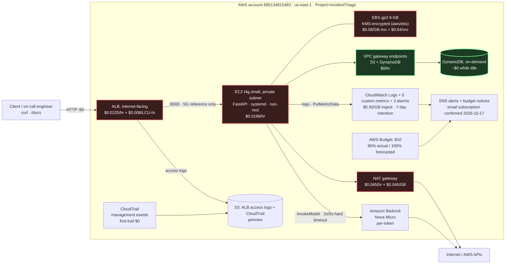
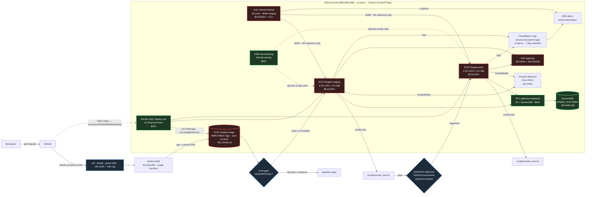

# Architecture

Two levels are deployed side by side. Level 1 is the CloudOps foundation (EC2);
Level 2 adds containerised delivery on ECS Fargate with a GitHub Actions pipeline.
The diagrams below carry the on-demand `us-east-1` rates in force on 2026-10-17
(read from the AWS Pricing API). **Red** components bill every hour the stack
exists; **green** ones cost nothing while idle. The live billing position and the
accounting behind these numbers are in the
[README](../README.md#cost--what-is-being-charged-right-now).

## Level 1 — CloudOps foundation

## Reading the diagram

- **One way in.** The ALB is internet-facing in public subnets and is the only path
  to the instance. It accepts `:80` from `0.0.0.0/0` and forwards to `:8000` using a
  **security-group reference** — the app SG has no CIDR rule at all
  ([why the instance is private](network-design.md)).
- **Two outbound paths.** AWS API calls leave through the NAT gateway (Bedrock) while
  **S3 and DynamoDB go through gateway VPC endpoints**, which cost $0/hr and keep that
  traffic off the NAT. Choosing gateway endpoints over interface endpoints is worth
  roughly $15/month here ([ADR-0002](adr/0002-nat-and-gateway-endpoints-for-egress.md)).
- **The application never holds credentials.** It calls DynamoDB, Bedrock, CloudWatch
  and Logs with short-lived credentials from the instance profile; the role is scoped
  to one table and one model ([permissions verbatim](security-and-threat-model.md)).
- **Everything leaves a trail.** CloudTrail records management events, the ALB writes
  access logs to S3, and the app writes structured JSON logs with `request_id`
  correlation to a 7-day log group.
- **The alert path was the weak link; it is now armed and checkable.** Both the
  alarms and the AWS Budget notify an SNS topic whose only email subscriber sat in
  `PendingConfirmation` from the first deploy, so nothing paged anyone — including
  through a real fault drill ([INC-0002](incidents/0002-fault-detection-latency-and-unconfirmed-alert-path.md)).
  The subscription is confirmed, and `scripts/adhoc/verify_alert_path.sh` fails
  loudly if any subscription is ever pending again, so this cannot silently return.

## What was actually deployed

Read back from the running stack on 2026-10-17 (`aws cloudformation
get-template` / `describe-*`), not from the source:

| Component | Live identifier |
| :--- | :--- |
| Stack | `IncidentTriage-level1` in `us-east-1`, account `685134815483` |
| Entry point | `http://Incide-Alb16-42G9qBLXchCg-1665380019.us-east-1.elb.amazonaws.com` |
| Target group | `Incide-AppTa-53LUD34DALJG` (health check `/health`, 15s interval, 3 unhealthy / 2 healthy) |
| Compute | `i-003f1651c312481d4`, `t4g.small`, private subnet `us-east-1a`, no public IP, `KeyName: null` |
| Identity | instance profile `IncidentTriage-level1-AppInstanceInstanceProfileC6B6EFAA-…` (IMDSv2 required) |
| State | DynamoDB `IncidentTriage-level1` (on-demand, SSE enabled) |
| Model | Bedrock `amazon.nova-micro-v1:0` |
| Logs | `/aws/ec2/incident-triage` (7-day retention) |
| Metrics | namespace `IncidentTriage`, dimension `Environment=level1` |
| Alerts | SNS topic `IncidentTriage-alerts-level1`, email subscription **confirmed** 2026-10-17 (was `PendingConfirmation` — [INC-0002](incidents/0002-fault-detection-latency-and-unconfirmed-alert-path.md)) |
| Audit | CloudTrail `IncidentTriage-level1` + `incidenttriage-level1-*` S3 buckets |

Cost and billing detail: [README § Cost](../README.md#cost--what-is-being-charged-right-now).
Threat model: [security-and-threat-model.md](security-and-threat-model.md).
Decisions and trade-offs: [ADRs](adr).

## Level 2 — containerised delivery

The same service, delivered differently: the artifact is an immutable container
image, it is verified before it is promoted, and the thing that promotes it holds no
long-lived credentials. Deployed and verified on 2026-10-18.

### Reading the Level 2 diagram

- **The artifact is immutable and identifiable.** Every image is tagged with the
  commit SHA in a repository whose tags cannot be repointed, so "what is running"
  and "which commit is that" are the same question
  ([ADR 0007](adr/0007-hashed-lock-and-single-manifest-image.md)).
- **Nothing is promoted unscanned.** The gate blocks HIGH/CRITICAL, fails closed on
  a scan it cannot read, and the only way past it is a dated, owned exception in
  `security/scan-exceptions.json`. It caught a real one immediately: an image that
  ECR could not scan at all ([INC-0003](incidents/0003-unscannable-image-blocked-the-scan-gate.md)).
- **Staging is verified, production is approved.** The staging job runs the smoke
  test against the live URL; production sits behind a GitHub Environment with a
  required reviewer. A release therefore has to pass *both* an automated contract
  and a human decision.
- **The pipeline holds no long-lived credentials and no infrastructure power.** It
  assumes a role via OIDC whose subject is pinned to this repo's deploy branch and
  its production environment, and that role can push images and move a service
  between revisions — nothing else. It cannot run CloudFormation, read the database,
  or change IAM ([ADR 0009](adr/0009-oidc-deploy-role-owns-the-artifact.md)).
- **Three roles, none interchangeable.** The ECS *execution* role pulls the image,
  writes logs and reads one secret; the *task* role touches one table and one model;
  the *deploy* role does neither of those and only moves artifacts
  ([permissions verbatim](security-and-threat-model.md)).
- **The secret is not in the template.** It is created out of band and imported, so
  it never appears in `cdk.out` or `cdk diff`
  ([ADR 0010](adr/0010-runtime-secrets-from-ssm.md), [evidence](evidence/level2-oidc-subject.md)).

### What was actually deployed (Level 2)

Read back from the running stacks on 2026-10-18:

| Component | Live identifier |
| :--- | :--- |
| Stacks | `IncidentTriage-level2-registry` and `IncidentTriage-level2` in `us-east-1` |
| Registry | `incident-triage` (`IMMUTABLE`, scan on push) |
| Entry points | prod `http://Incide-Alb16-BRvGrTmJ306X-1019014256.us-east-1.elb.amazonaws.com` · staging the same host on `:8080` |
| Services | `incident-triage-staging`, `incident-triage-prod` (cluster `incident-triage-level2`) |
| Compute | 2 × Fargate `0.25 vCPU / 512 MiB`, private subnets, `AssignPublicIp: DISABLED` |
| Running version | tag `331dfbe` in both environments (deployed by the pipeline, approved at the gate) |
| State | DynamoDB `IncidentTriage-staging`, `IncidentTriage-prod` (separate tables per environment) |
| Secret | SSM SecureString `/incident-triage/level2/{staging,prod}/internal-api-key` (created out of band) |
| Deploy identity | `arn:aws:iam::685134815483:role/incident-triage-level2-github-deploy` (OIDC, subject-pinned) |
| Logs | `/aws/ecs/incident-triage`, streams prefixed `staging/` and `prod/` |
| Alarms | `IncidentTriage-level2-{staging,prod}-alb-{unhealthy-targets,5xx}` → SNS `IncidentTriage-alerts-level2` |
| Pipeline | `.github/workflows/pipeline.yml` on `zor-neo/ai-incident-triage-poc`; a successful run is `lint + synth → build → scan → stage → approve → prod` |

Runbook: [level2-runbook.md](runbooks/level2-runbook.md).
Incidents from this level: [INC-0003](incidents/0003-unscannable-image-blocked-the-scan-gate.md),
[INC-0004](incidents/0004-bad-release-promoted-to-staging.md).
OIDC evidence: [evidence/level2-oidc-subject.md](evidence/level2-oidc-subject.md).
