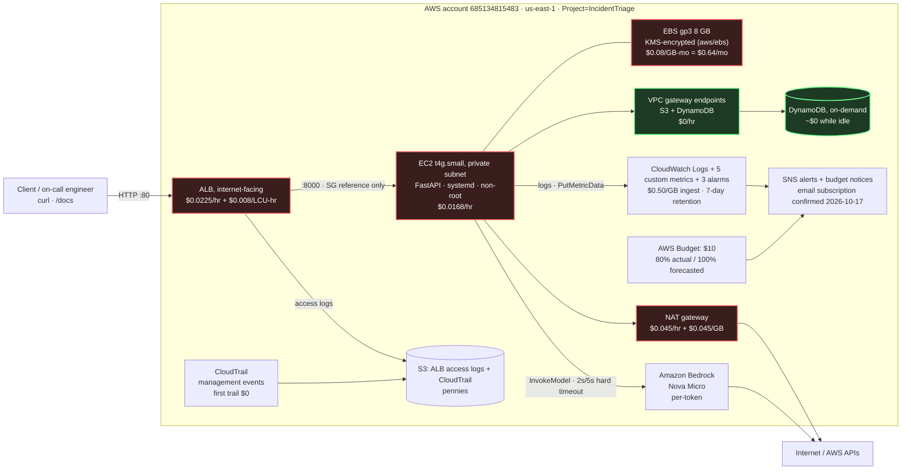

# Level 1 architecture

The deployed Level 1 stack, with the on-demand `us-east-1` rates in force on
2026-10-17 (read from the AWS Pricing API). **Red** components bill every hour the
stack exists; **green** ones cost nothing while idle. The live billing position and
the accounting behind these numbers are in the
[README](../README.md#cost--what-is-being-charged-right-now).

## Reading the diagram

- **One way in.** The ALB is internet-facing in public subnets and is the only path
  to the instance. It accepts `:80` from `0.0.0.0/0` and forwards to `:8000` using a
  **security-group reference** — the app SG has no CIDR rule at all
  ([why the instance is private](network-design.md)).
- **Two outbound paths.** AWS API calls leave through the NAT gateway (Bedrock) while
  **S3 and DynamoDB go through gateway VPC endpoints**, which cost $0/hr and keep that
  traffic off the NAT. Choosing gateway endpoints over interface endpoints is worth
  roughly $15/month here ([ADR-0002](adr/0002-nat-and-gateway-endpoints-for-egress.md)).
- **The application never holds credentials.** It calls DynamoDB, Bedrock, CloudWatch
  and Logs with short-lived credentials from the instance profile; the role is scoped
  to one table and one model ([permissions verbatim](security-and-threat-model.md)).
- **Everything leaves a trail.** CloudTrail records management events, the ALB writes
  access logs to S3, and the app writes structured JSON logs with `request_id`
  correlation to a 7-day log group.
- **The alert path was the weak link; it is now armed and checkable.** Both the
  alarms and the AWS Budget notify an SNS topic whose only email subscriber sat in
  `PendingConfirmation` from the first deploy, so nothing paged anyone — including
  through a real fault drill ([INC-0002](incidents/0002-fault-detection-latency-and-unconfirmed-alert-path.md)).
  The subscription is confirmed, and `scripts/adhoc/verify_alert_path.sh` fails
  loudly if any subscription is ever pending again, so this cannot silently return.

## What was actually deployed

Read back from the running stack on 2026-10-17 (`aws cloudformation
get-template` / `describe-*`), not from the source:

| Component | Live identifier |
| :--- | :--- |
| Stack | `IncidentTriage-level1` in `us-east-1`, account `685134815483` |
| Entry point | `http://Incide-Alb16-42G9qBLXchCg-1665380019.us-east-1.elb.amazonaws.com` |
| Target group | `Incide-AppTa-53LUD34DALJG` (health check `/health`, 15s interval, 3 unhealthy / 2 healthy) |
| Compute | `i-003f1651c312481d4`, `t4g.small`, private subnet `us-east-1a`, no public IP, `KeyName: null` |
| Identity | instance profile `IncidentTriage-level1-AppInstanceInstanceProfileC6B6EFAA-…` (IMDSv2 required) |
| State | DynamoDB `IncidentTriage-level1` (on-demand, SSE enabled) |
| Model | Bedrock `amazon.nova-micro-v1:0` |
| Logs | `/aws/ec2/incident-triage` (7-day retention) |
| Metrics | namespace `IncidentTriage`, dimension `Environment=level1` |
| Alerts | SNS topic `IncidentTriage-alerts-level1`, email subscription **confirmed** 2026-10-17 (was `PendingConfirmation` — [INC-0002](incidents/0002-fault-detection-latency-and-unconfirmed-alert-path.md)) |
| Audit | CloudTrail `IncidentTriage-level1` + `incidenttriage-level1-*` S3 buckets |

Cost and billing detail: [README § Cost](../README.md#cost--what-is-being-charged-right-now).
Threat model: [security-and-threat-model.md](security-and-threat-model.md).
Decisions and trade-offs: [ADRs](adr).
